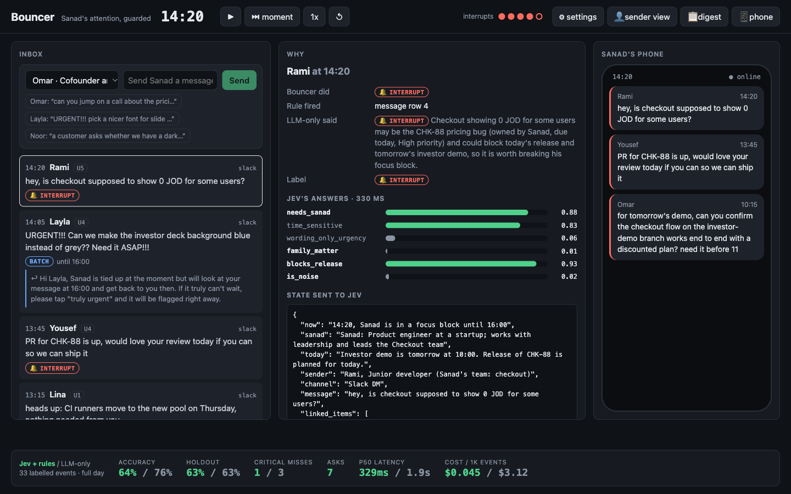

# Bouncer

**Lets the important ping through. Holds the loud one at the door.**

  

Bouncer is an attention filter for a busy engineer. Every Slack DM, email, calendar change and failed CI run becomes one event. [Jev](https://docs.typesafe.ai), TypeSafe's System One model, answers a few small judgments about the event. Plain code then decides whether to interrupt, batch, delegate or drop it. An LLM only writes the text: auto-replies, CI explanations and the evening digest.



## What it does

- **Loud vs quiet.** The CEO's `URGENT!!!` about a slide colour waits until the next free slot, with an auto-reply. A teammate's quiet "is checkout supposed to show 0 JOD?" interrupts.
- **Jev judges, code decides.** Jev answers six yes/no questions with probabilities. Then [a truth table you can read](design/04-policy.md) turns them into an action. Every decision on screen shows the answers, the rule that fired and the exact state Jev saw.
- **Measured against an LLM-only router.** The same 33 events go through Claude Sonnet 5.5, which picks the action directly. Both are scored against hand labels, and the losses are shown too.

## Quickstart

You need Python 3.12 and Node 18 or later. The seeded day works without API keys, because the repo ships with the model outputs.

```bash
git clone <this repo> && cd jev-bouncer
make install   # Python venv + frontend packages
make app       # builds the frontend and serves everything on http://localhost:8000
```

- **http://localhost:8000**: the app. Press **⏭ moment** to step through the demo, or **▶** to play the day.
- **Send a message live:** pick a sender, type, and send. Jev routes it in about a second, and the LLM writes the auto-reply. Live messages need `OPENROUTER_API_KEY` in `.env` (`cp .env.example .env`). Without a key, a live message is stored as ERROR and says why.
- **http://localhost:8000/test**: the test bench. Enter any notification (sender, source, time, text, or a CI failure) and see the full response: the decision, the rule that fired, Jev's answers, the state it saw and what the LLM wrote. It runs as a dry run unless you untick it.
- **http://localhost:8000/phone**: Sanad's phone on its own. Open it on a real phone on the same wifi, using your laptop's IP address.
- **http://localhost:8000/slides/**: the deck. Its numbers come from the running server.
- **⚙ settings:** change the budget, the "sure" band or who counts as family. The server re-routes the whole day, and the numbers update.

**Raw payloads through the adapters**, for example a Slack event:

```bash
curl -X POST localhost:8000/api/ingest/slack -H 'Content-Type: application/json' -d @data/raw/slack/rami-dm.json
```

**Other commands:**

```bash
make test      # pytest: adapters, state, Jev client, pipeline, policy, metrics, store, API
make eval      # rebuilds data/results.json from pipeline/cache and prints the table below (no network)
make pipeline  # reruns Jev + the LLM for anything not in pipeline/cache (needs the key)
make dev       # API with --reload on :8000, Vite dev server on :5173
```

## The numbers

These come from `make eval`, computed by [`server/metrics.py`](server/metrics.py) from [`data/results.json`](data/results.json) at default settings.
- **Models:** `typesafe/jev-1.14` vs `anthropic/claude-sonnet-5.5` at its default reasoning effort, both through OpenRouter.
- **Run:** 2026-11-14.
- **Data:** n = 33 events (29 messages, 4 CI failures); 8 are holdout events that weren't looked at while writing the questions.

| Metric | Jev + rules | LLM only |
|---|---|---|
| Accuracy, all events | 64% | **76%** |
| Accuracy, holdout | 63% | 63% |
| Accuracy, messages | 59% | **72%** |
| Accuracy, CI failures | 100% | 100% |
| Critical misses (should have interrupted) | **1** | 3 |
| Asks (counted as wrong) | 7 | – |
| Latency per call, p50 / p95 | **329 ms / 409 ms** | 1916 ms / 5047 ms |
| Routing cost per 1,000 events | **$0.045** | $3.123 |

How to read it:
- **The LLM wins on raw accuracy.** Most of Jev's gap is the 7 "ask" decisions. When Jev is unsure whether Sanad is needed, Bouncer asks him instead of guessing, and the metric counts every ask as wrong.
- **Jev + rules misses fewer interrupts** (1 vs 3).
- **Jev is about 6× faster and about 70× cheaper per routing decision.** Costs are measured from each call's `usage.cost`.
- **Every Jev decision can be explained** by the answers and a numbered rule.

## How it works

```
 React app (inbox · why · phone · settings)        curl / webhook (raw Slack, GitHub, Gmail)
              │  polls /api every second                      │
              ▼                                               ▼
 FastAPI server ─► adapters ─► unified event ─► context builder ─► Jev (judgments, ~0.3 s)
       │                                                           │
   SQLite (events, model outputs, settings, feedback)    policy.py (rules) ─► action
                                                                   │
                                        LLM writes the text in the background ┘
```

1. **[Adapters](pipeline/adapters/)** turn each source's payload into one event shape ([design/13](design/13-adapters.md)).
2. **[The context builder](pipeline/state.py)** adds what a person would look at: who the sender is, Sanad's calendar right now, linked tickets and PRs ([design/02](design/02-context-builder.md)).
3. **[Jev](pipeline/questions.py)** answers typed questions: `needs_sanad`, `time_sensitive`, `wording_only_urgency`, `family_matter`, `blocks_release` and `is_noise`. For CI failures it answers `failure_type`, `cause_identifiable` and `blocks_release` instead ([design/03](design/03-jev-questions.md)).
4. **[The policy](server/policy.py)** maps answers to an action, first matching row wins ([design/04](design/04-policy.md)):

| # | When | Action |
|---|---|---|
| 1 | Family, unless Jev is sure it can wait | interrupt (a family message that can wait is held) |
| 2 | Evening, not family, doesn't block the release | hold until 09:00 |
| 3 | Noise | drop |
| 4 | Blocks the release and needs Sanad | interrupt |
| 5 | Sounds urgent but isn't | hold + auto-reply |
| 6 | Unsure whether Sanad is needed | ask Sanad |
| 7 | Doesn't need Sanad | delegate (leadership is held instead) |
| 8 | Time-sensitive, budget left, above the rising bar | interrupt (uses budget) |
| 9 | Otherwise | hold until the next free slot |

5. **[The LLM](pipeline/llm.py)** writes auto-replies, CI explanations and the digest ([design/05](design/05-llm-jobs.md)). Every prompt is in that one file.
6. **[The server](server/app.py)** keeps everything in SQLite and recomputes decisions on every read, so a settings change re-routes the whole day ([design/14](design/14-app.md)).

The full design is in [`design/`](design/README.md).

## Limits

- **The data is fictional.** It covers one persona, one day and 33 events, so read the numbers as a demo, not a benchmark.
- **The labeller is also the builder.** After the first real run, one label and three policy rules were corrected. Every change is logged in [`data/CHANGELOG.md`](data/CHANGELOG.md), and both models are scored on the same final labels.
- **The baseline is one prompt.** A better-prompted LLM might score higher.
- **Only the labelled day is scored.** Live messages have no labels, so they are routed and shown but never counted in the numbers. The LLM-only baseline runs only on the labelled set.

## Real integrations and privacy

- **Adding a source.** A new source is one adapter module plus a fixture in `data/raw/<source>/`, and the contract tests pick it up automatically. Slack, Gmail, GitHub Actions and Google Calendar adapters are included. `github_actions` can fetch a real failed run with the `gh` CLI.
- **Privacy.** Personal sources (Gmail, Calendar) are meant to be opt-in. Only the state for each event is sent to the models, and keys stay in `.env`, which is gitignored.
- **Slides.** The deck is in [`slides/`](slides/index.html). It reads `/api/metrics` from the running server, so its numbers always match this table.

## License

[MIT](LICENSE)
